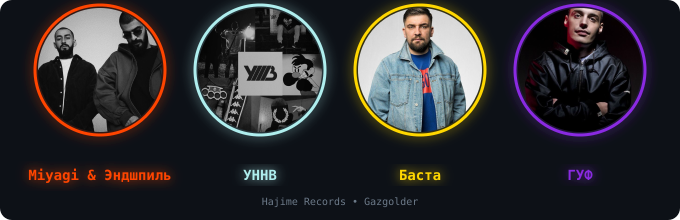
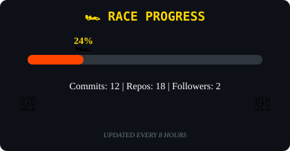
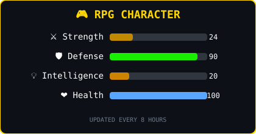
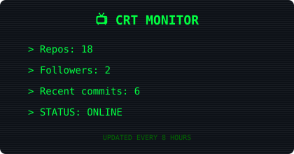

# Привет, я Мотя 👋

**Fullstack-разработчик** · Челябинск, Россия

Собираю интерфейсы, которые хочется трогать: веб-приложения, 3D-открытки, мобильные игры и ботов.

---

## 🎧 В ушах сейчас

  

Блок рисуется Python-скриптом и обновляется сам — раз в неделю через GitHub Actions.

---

## 🚀 Что я делаю

- **Веб-приложения** — React + TypeScript на клиенте, ASP.NET Core и SQL Server на сервере
- **Интерактив и 3D** — Three.js, canvas, CSS-анимации, многослойные переходы
- **Мобильные приложения** — Flutter/Dart и React Native + Expo
- **Телеграм-боты** — Python и pyTelegramBotAPI
- **Дизайн в коде** — тёмные неоновые темы, стекло, адаптив без макетов

## 🧰 Стек

 

 

## ✨ Избранные проекты

| Проект | О проекте | Стек | Ссылки |
| :--- | :--- | :--- | :--- |
| **VolunteerSystem** | Платформа для волонтёрских мероприятий: регистрация, роли, геопоиск адресов | ASP.NET Core · EF Core · SQL Server · React | [Код](https://github.com/Moty2111/VolunteerSystem) |
| **Monopolist** | Учёт строительного магазина: товары, заказы, 3 языка, 2FA, тёмная тема | ASP.NET Core 9 · Razor Pages | [Демо](https://moty2111.github.io/Monopolist/) · [Код](https://github.com/Moty2111/Monopolist) |
| **Halloween 2026** | Интерактивная игра-открытка с мини-игрой и карточками персонажей | HTML · CSS · JS | [Демо](https://moty2111.github.io/halloween-2026/) · [Код](https://github.com/Moty2111/halloween-2026) |
| **Цветочек** | Flutter-приложение: выращивание цветка, гороскоп, таро и заметки | Flutter · Dart | [Код](https://github.com/Moty2111/Flowers-) |
| **Katuysha** | 3D-открытка с тортом, драконом и мини-играми на Three.js | Three.js · Vanilla JS | [Демо](https://moty2111.github.io/Katuysha/) · [Код](https://github.com/Moty2111/Katuysha) |
| **BuildPro** | Витрина стройматериалов с каталогом и корзиной | HTML · CSS · JS | [Демо](https://moty2111.github.io/My-sawes2/) · [Код](https://github.com/Moty2111/My-sawes2) |

## 🎮 Игровая статистика

  
  
  

## 🐍 Мои коммиты

  

## 📁 Все работы

На сайте — все **16 проектов** с фильтрами по категориям, поиском, галереями скриншотов и ссылками на живые демо. Есть светлая тема и переключение RU/EN.

**[→ Открыть портфолио](https://moty2111.github.io/portfolio/)**

## 📬 Связаться

- Telegram — [@Moty0104](https://t.me/Moty0104)
- Email — [matwey6633@gmail.com](mailto:matwey6633@gmail.com)
- Портфолио — [moty2111.github.io/portfolio](https://moty2111.github.io/portfolio/)

Дизайн и код — Мотя. 2025–2026.

